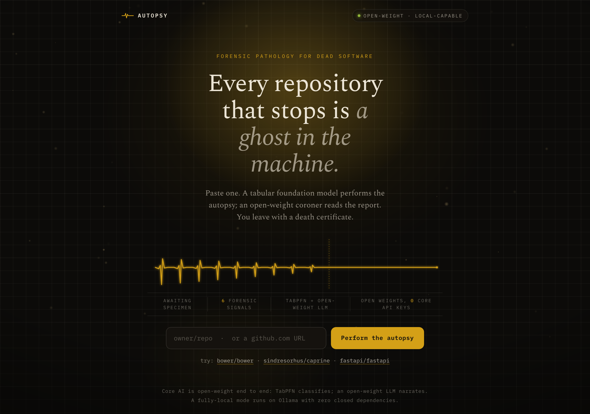
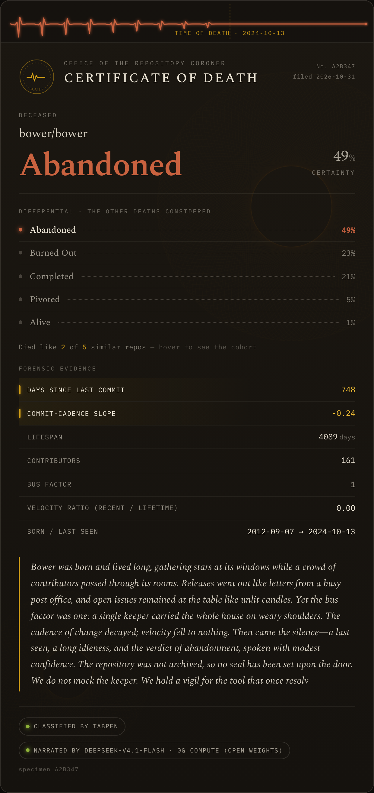
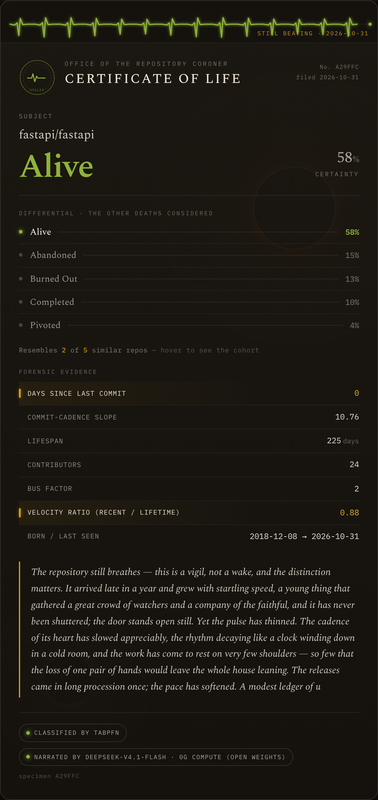

# Autopsy of a Dead Project

Paste a GitHub repo URL. An open-weight AI performs a forensic autopsy, classifies how the project died, reads a grounded coroner's eulogy, and hands you an amber death certificate.

[](https://github.com/dmustapha/autopsy-of-a-dead-project/actions/workflows/test.yml)


**Live:** https://autopsy.132-145-100-81.sslip.io



---

## What it is

A single-page FastAPI app that reads a GitHub repository's public history and answers one question: *is this project alive, and if not, how did it die?*

The flow, from one pasted URL:

1. **Extract:** pull the repo's commit cadence, contributor spread, lifespan, and staleness from the GitHub API into six numeric features.
2. **Classify:** a local open-weight tabular model sorts the project into one of five death modes: `abandoned`, `burned_out`, `alive`, `completed`, or `pivoted`.
3. **Narrate:** a decentralized open-weight LLM writes a 120-200 word coroner's eulogy, grounded strictly in the evidence (it may evoke the story, but every factual claim is bound to a real metric).
4. **Certify:** the verdict renders as an amber "death certificate" card: cause of death, dates, confidence, and the narrated report.

Two example verdicts, rendered live:




## Theme: Ghost in the Machine

Built for DEV's Hacktoberfest Week 4 "Ghost in the Machine" challenge. The interpretation is literal and a little mournful: most software dies, quietly and without ceremony. This is a memorial for dead repositories. It holds a vigil instead of mocking the maintainer, and it reads the eulogy the way a coroner reads a report, Dia-de-los-Muertos reverence over a cold table of facts.

## How open-source AI is used

Two open-weight engines, each doing the thing it is actually good at. No closed model touches the verdict or the prose.

### Classification engine: local TabPFN (on-device)

The death-mode call is made by **TabPFN** (`tabpfn==9.2.0` + `torch`), Prior Labs' tabular foundation model, running **genuinely on-device**, no hosted inference dependency. It is loaded once per process and fit on a 47-row seed of famous projects as in-context examples; every prediction is then a forward pass.

Honest separability, measured by leave-one-out cross-validation on the seed:

| Metric | Value | Evidence |
|---|---|---|
| LOO accuracy (5-class) | **17 / 47 = 36.2%** | `scripts/build_seed.py` LOO snippet over `data/seed_repos.csv` |
| Chance baseline | 20% | 5 balanced classes |
| 1-NN proxy baseline | 31% | same seed, same features |

Modest but real: predicting a repo's death-mode from six features on 47 examples is a genuinely hard problem, and the model beats both chance and a nearest-neighbor proxy. This is the confirmed entry for the **Best Use of TabPFN** category.

### Narration engine: 0G Compute decentralized LLM

The eulogy is written by **`deepseek-v4.1-flash`**, an open-weight model served over the **0G Compute** decentralized compute network via `https://router-api.0g.ai/v1`. The certificate card carries an honest badge: *"narrated by deepseek-v4.1-flash · 0G Compute (open weights)."*

A local Gemma-via-Ollama path exists in the code as a keyless fallback, but it was capacity-blocked on the small deployment box, so **0G Compute is the live narrator**, not Gemma. A templated, self-labeled fallback ("Generated without the language model.") covers the case where no LLM is reachable, so the app never fabricates prose.

The grounding is enforced, not hoped for: any number in the eulogy must bind to a real evidence metric, or it is rejected. See `app/narrator.py` and `tests/test_narration_grounding.py`.

## Live URL and latency

Live: https://autopsy.132-145-100-81.sslip.io (`/`, `/healthz`, `/examples`, `/autopsy` all return 200).

Honest latency on the small Oracle box:

- **Cached example repos** (bower, caprine, fastapi): instant.
- **A fresh repo autopsy:** ~20-40s (the 0G reasoning call dominates).
- **Cold start:** ~60-120s while torch loads the TabPFN weights the first time.

## Running locally

```bash
git clone https://github.com/dmustapha/autopsy-of-a-dead-project.git
cd autopsy-of-a-dead-project

python3 -m venv .venv && source .venv/bin/activate
pip install -r requirements.txt

cp .env.example .env          # fill in TABPFN_TOKEN + 0G narration vars (both optional for the fallback paths)
uvicorn app.main:app --reload
```

Then open http://localhost:8000 and paste a GitHub repo URL.

Environment is documented in `.env.example`: the local TabPFN path and the 0G / Gemma / Groq narration options. With no keys at all, classification falls back to a labeled rules heuristic and narration to the self-labeled template, so the app still runs end to end.

## Tests

```bash
pytest -q          # 50 offline, deterministic, zero-credential tests
```

The suite is offline-only by design, so a green run can never fake live-network proof. It mocks the LLM client and disables TabPFN to exercise the fallbacks, and asserts the honesty invariants (grounding, no digit-smuggling across metric fields). The same gate runs in CI on every push (`.github/workflows/test.yml`). Live-network verification happens at deploy time.

A fuller release gate that adds a secret scan and a recompute-and-diff of the evidence artifacts lives in `scripts/verify.sh`.

## Project structure

```
app/            FastAPI app
  main.py         routes: / , /autopsy , /examples , /healthz
  extractor.py    GitHub API -> raw repo history
  features.py     raw history -> 6 numeric features
  classifier.py   local TabPFN fit/predict (+ labeled-rules fallback)
  narrator.py     0G Compute eulogy, grounded (+ templated fallback)
  schemas.py      pydantic models, FEATURE_ORDER
  static/ , templates/   the death-certificate card
data/           seed_repos.csv (47 labeled projects) + notes
scripts/        build_seed.py (LOO check), verify.sh, recompute.sh
tests/          offline test suite + honesty falsification tests
deploy/         systemd unit + nginx config + runbook (the live box)
docs/           claims ledger + images
```

## Documentation

- [`ARCHITECTURE.md`](ARCHITECTURE.md) : system design and the engine choices
- [`DECISIONS.md`](DECISIONS.md) : the ADR log (why 0G, why local TabPFN, why no closed model)
- [`INVARIANTS.md`](INVARIANTS.md) : the honesty invariants the tests enforce
- [`SECURITY.md`](SECURITY.md) : threat surface for a keyless public endpoint
- [`LIMITATIONS.md`](LIMITATIONS.md) : honest scope boundaries

## License

MIT © 2026 Damilola Mustapha
